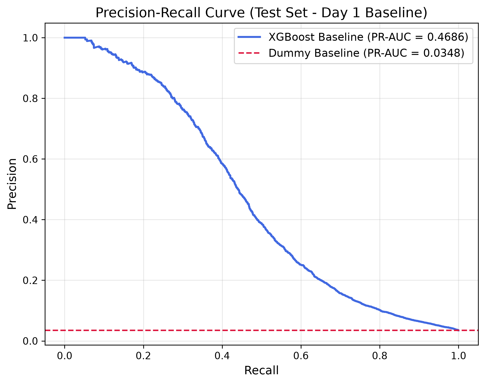

# Fraud & Risk Investigator

A fraud detection and risk investigation system that scores transactions using machine learning, retrieves policy and past-case context from a vector database, and generates grounded, human-readable alert explanations.

---

## 1. Problem
Financial fraud detection operates under severe class imbalance: only ~3.5% of transactions are fraudulent. Traditional evaluation metrics like raw classification accuracy are deceptive because a naive model that predicts "never fraud" achieves ~96.5% accuracy while catching zero fraudulent transactions. In production risk systems, the cost of a False Negative (a missed fraudulent transaction resulting in direct chargebacks and financial loss) is typically orders of magnitude higher than a False Positive (a temporary transaction verification or customer friction). The objective is to build an honest, robust ML system evaluated on precision-recall metrics and cost-sensitive thresholds rather than arbitrary default cutoffs.

---

## 2. Data
The system is built on the IEEE-CIS Fraud Detection dataset:
- **`train_transaction.csv`**: 590,540 transactions across 394 features.
- **`train_identity.csv`**: 144,233 identity records across 41 features.
- **Joined Dataset**: Left-joined on `TransactionID` $\rightarrow$ 590,540 rows $\times$ 434 columns.
- **Input Features**: 431 features used for modeling after dropping `isFraud` (target label), `TransactionID` (arbitrary identifier), and raw `TransactionDT` (absolute timestamp that cannot generalize forward in tree-based splits).
- **Categorical Handling**: 31 categorical columns (14 from transaction, 17 from identity). Categorical levels are strictly learned from the training set only; unseen categories in validation and test are encoded as missing values to prevent data leakage.

---

## 3. Time-Based Split
Transactions are ordered chronologically by `TransactionDT` (time elapsed since a reference point) and split by row positions to mirror real-world production deployment:
- **Train (Oldest 70%)**: 413,378 rows | Fraud rate: 3.517% | `TransactionDT`: 86,400 to 10,437,996
- **Validation (Middle 15%)**: 88,581 rows | Fraud rate: 3.434% | `TransactionDT`: 10,438,003 to 13,151,840
- **Test (Newest 15%)**: 88,581 rows | Fraud rate: 3.480% | `TransactionDT`: 13,151,880 to 15,811,131

**Why no random shuffling**: A model in production must predict future transactions using only past historical data. Shuffling transactions randomly leaks future behavioral patterns and fraud rings into the past, producing artificially inflated scores that fail when deployed live.

---

## 4. Baseline Results (Day 1)
Baseline model: `XGBClassifier(tree_method="hist", enable_categorical=True, eval_metric="aucpr", early_stopping_rounds=50)` trained on Train and stopped at best iteration on Validation.

| Metric | Baseline Score | Context |
| :--- | :--- | :--- |
| **Dummy PR-AUC** | **0.0348** | Baseline to beat (equals test fraud prevalence of 3.48%) |
| **Validation PR-AUC** | **0.5630** | Peak validation score (best iteration = 599) |
| **Test PR-AUC** | **0.4686** | 13.5x over dummy baseline; gap reflects validation stopping selection & temporal drift |
| **Test ROC-AUC** | **0.8626** | Strong global ranking capability |
| **Precision (at 0.5 cutoff)** | **75.4%** | 949 true frauds out of 1,258 flags |
| **Recall (at 0.5 cutoff)** | **30.8%** | Only 949 out of 3,083 actual frauds caught (**69.2% missed**) |

### Confusion Matrix (Test Set @ Threshold 0.5)
- **True Negatives (TN)**: 85,189
- **False Positives (FP)**: 309
- **False Negatives (FN)**: 2,134
- **True Positives (TP)**: 949

> **Key Takeaway**: At the default 0.5 threshold, precision looks respectable (75.4%), but 2,134 fraudulent transactions slip through undetected. Because missed fraud carries high business cost, Day 2 focuses on class imbalance handling, feature engineering, and cost-based threshold optimization.
