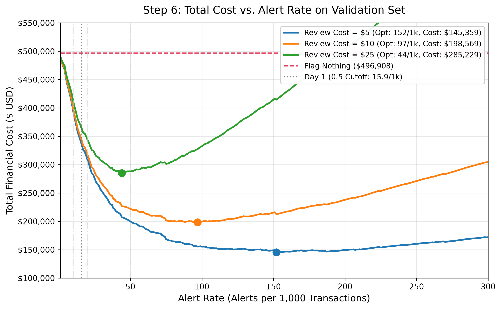

# Fraud & Risk Investigator

A fraud detection and risk investigation system that scores transactions using machine learning, retrieves policy and past-case context from a vector database, and generates grounded, human-readable alert explanations.

---

## 1. Problem
Financial fraud detection operates under severe class imbalance: only ~3.5% of transactions are fraudulent. Traditional evaluation metrics like raw classification accuracy are deceptive because a naive model that predicts "never fraud" achieves ~96.5% accuracy while catching zero fraudulent transactions. In production risk systems, the cost of a False Negative (a missed fraudulent transaction resulting in direct chargebacks and financial loss) is typically orders of magnitude higher than a False Positive (a temporary transaction verification or customer friction). The objective is to build an honest, robust ML system evaluated on precision-recall metrics and cost-sensitive thresholds rather than arbitrary default cutoffs.

---

## 2. Data
The system is built on the IEEE-CIS Fraud Detection dataset:
- **`train_transaction.csv`**: 590,540 transactions across 394 features.
- **`train_identity.csv`**: 144,233 identity records across 41 features.
- **Joined Dataset**: Left-joined on `TransactionID` $\rightarrow$ 590,540 rows $\times$ 434 columns.
- **Input Features**: 431 features used for modeling after dropping `isFraud` (target label), `TransactionID` (arbitrary identifier), and raw `TransactionDT` (absolute timestamp that cannot generalize forward in tree-based splits).
- **Categorical Handling**: 31 categorical columns (14 from transaction, 17 from identity). Categorical levels are strictly learned from the training set only; unseen categories in validation and test are encoded as missing values to prevent data leakage.
- **Masked Columns**: Column meanings are masked per Vesta Corporation's schema. Only category-level descriptions are documented: `D` are time deltas, `M` are match flags, `C` are counting metrics, `dist` are geographic/network distances, and `V` are Vesta-engineered features. No unverified domain interpretations are asserted.

---

## 3. Time-Based Split
Transactions are ordered chronologically by `TransactionDT` (time elapsed since a reference point) and split by row positions using a stable sort to mirror real-world production deployment:
- **Train (Oldest 70%)**: 413,378 rows | Fraud rate: 3.517% | `TransactionDT`: 86,400 to 10,437,996 (~121 days)
- **Validation (Middle 15%)**: 88,581 rows | Fraud rate: 3.434% | `TransactionDT`: 10,438,003 to 13,151,840 (~31 days)
- **Test (Newest 15%)**: 88,581 rows | Fraud rate: 3.480% | `TransactionDT`: 13,151,880 to 15,811,131 (~31 days)

**Why no random shuffling**: A fraud model in production must predict future transactions using only past historical data. Random shuffling allows trees to memorize future behavioral patterns and fraud rings, yielding unrealistically optimistic scores that collapse when deployed live.

---

## 4. Baseline Results (Day 1)
Baseline model: `XGBClassifier(tree_method="hist", enable_categorical=True, eval_metric="aucpr", early_stopping_rounds=50)` trained on Train and stopped at best iteration on Validation.

| Metric | Baseline Score | Context |
| :--- | :--- | :--- |
| **Dummy PR-AUC** | **0.0348** | Baseline to beat (equals test fraud prevalence of 3.48%) |
| **Validation PR-AUC** | **0.5630** | Peak validation score (best iteration = 599) |
| **Test PR-AUC** | **0.4686** | 13.5x over dummy baseline; gap reflects validation stopping selection & temporal drift |
| **Test ROC-AUC** | **0.8626** | Strong global ranking capability |
| **Precision (at 0.5 cutoff)** | **75.4%** | 949 true frauds out of 1,258 flags |
| **Recall (at 0.5 cutoff)** | **30.8%** | Only 949 out of 3,083 actual frauds caught (**69.2% missed**) |

### Confusion Matrix (Test Set @ Threshold 0.5)
- **True Negatives (TN)**: 85,189 | **False Positives (FP)**: 309
- **False Negatives (FN)**: 2,134 | **True Positives (TP)**: 949

---

## 5. Temporal Drift & Adversarial Validation (Day 2)
Adversarial classifiers (distinguishing sample time periods without fraud labels) were trained to quantify distribution shifts over time:
- **Train vs. Validation ROC-AUC**: **0.8702** (the periods are clearly distinguishable)
- **Validation vs. Test ROC-AUC**: **0.7284** (closer in time, but still distinct)
- **Train vs. Test ROC-AUC**: **0.8886** (largest shift across the full 6-month timeline)

### Drift Evidence & Limitations
1. **`M1` Match Feature**: Missingness plunged from **69.6%** in Train down to **25.7%** in Test. Crucially, the fraud rate among missing `M1` records surged from **2.8%** to **9.9%**, while `M1 == True` remained constant (~2.0%).
2. **`id_31` Browser Field**: Chronological progression of browser version numbers (Chrome 62/63 $\rightarrow$ 64 $\rightarrow$ 65 $\rightarrow$ 66).
3. **Identity Coverage**: Identity table join match rate dropped from ~42% in early periods to 17–20% in later periods.
4. **Adversarial Validation Scope**: Adversarial AUC diagnoses covariate shift (changes in input distributions), but does not detect concept drift (changes in how inputs relate to fraud, such as the `M1` missing fraud surge).

---

## 6. Feature Engineering & Stationarity
To reduce vulnerability to drift while maintaining stationary signal:
- **Relative Time Features**:
  - `hour_of_day = (TransactionDT // 3600) % 24`
  - `day_of_week = (TransactionDT // 86400) % 7`
- **Browser & OS Categorical Aggregation**: Grouped high-cardinality version strings into broad families (`chrome`, `safari`, `firefox`, `edge`, `windows`, `ios`, `mac`, `android`, etc.).
- **Backward-Looking Card Velocity & Ratios (`card1`)**:
  - Running transaction counts over rolling time horizons: `card1_trans_count_1h`, `card1_trans_count_24h`, `card1_trans_count_7d`.
  - Velocity: `card1_sec_since_prev` (seconds elapsed since prior transaction on this card; first transaction is strictly `NaN`).
  - Spending deviation: `card1_amt_ratio_to_prev_avg` (ratio of current amount to card's historical cumulative average; first transaction is strictly `NaN`).
- **Normalized Epoch Deltas**:
  - `D1_norm = D1 - (TransactionDT / 86400.0)`: Subtracting elapsed days anchors the initial card registration point to a fixed timeline epoch, transforming a shifting delta into a stationary client fingerprint.

---

## 7. Noise Study & Controlled Feature Ablation
### Training Shuffle Noise Study
Re-running the baseline across 5 training row-order permutations revealed intrinsic XGBoost `hist` variance:
- **Baseline Validation PR-AUC**: Mean = **0.5600**, $\sigma(n-1) = 0.0071$, Range = **0.0200** (0.5496 to 0.5696).
- **Methodological Rule**: Any observed validation gain $< 0.015 - 0.020$ is indistinguishable from single-run training noise.

### 12-Run Controlled Ablation (Fixed 350 Trees, No Early Stopping)
To isolate feature signal from early-stopping selection bias, models were trained for exactly 350 trees across 3 random seeds ($n-1$ sample standard deviation):

| Feature Configuration | Val PR-AUC Mean | Val PR-AUC $\sigma(n-1)$ | Val PR-AUC Range | $\Delta$ vs Baseline Mean (0.5600) | Conclusion |
| :--- | :---: | :---: | :---: | :---: | :--- |
| **Day 1 Raw Baseline (Fixed 350 Trees)** | 0.5624 | 0.0103 | 0.0195 | +0.0024 | Working reference |
| **Core Rolling Windows** | 0.5655 | 0.0039 | 0.0073 | +0.0055 | Within noise band; kept for stationarity |
| **Core + `D1_norm`** | **0.5809** | **0.0006** | **0.0012** | **+0.0209** | **Proven signal exceeding noise ($\sim 3\sigma$) on validation** |
| **Core + `D1_norm` + `D2_norm`** | 0.5807 | 0.0096 | 0.0180 | +0.0207 | Zero mean gain; 16x higher variance |
| **Core + Six D-Columns Normalized** | 0.5669 | 0.0034 | 0.0064 | +0.0069 | Earlier 0.6068 was early-stopping artifact |

**Locked Feature Set**: **Core Rolling Windows + `D1_norm`**.

---

## 8. Class Imbalance & Model Comparison
### Handling Class Imbalance (3.5% Fraud Prevalence)
Tested across 3 runs each (350 fixed trees, locked features):
- **Unweighted Training**: Mean Val PR-AUC = **0.5809** ($\sigma = 0.0006$) $\rightarrow$ **Selected**.
- **Mild Weighting (`scale_pos_weight = 5.0`)**: Mean Val PR-AUC = 0.5810 ($\sigma = 0.0018$, no measurable benefit).
- **Full Inverse Weighting (`scale_pos_weight = 27.4`)**: Mean Val PR-AUC = 0.5403 (-0.0406 vs unweighted).
- **Random Undersampling 1:4**: Mean Val PR-AUC = 0.5664 (-0.0145 vs unweighted).
- **Random Undersampling 1:1**: Mean Val PR-AUC = 0.5282 (-0.0527 vs unweighted).

> **Client Overlap Note**: 98.9% of validation transactions come from `card1` identifiers seen in training. Unseen cards represent only 1.1% (49 frauds), meaning validation metrics predominantly measure returning clients; novel card performance is statistically unmeasurable on validation.

### Model Architecture Comparison (3 Runs Each)
- **XGBoost (Locked, Unweighted)**: Val PR-AUC = **0.5809** ($\sigma = 0.0006$) | Training Time: **22.2s**
- **Random Forest (150 trees, max depth 14, sqrt features)**: Val PR-AUC = **0.4787** ($\sigma = 0.0017$) | Training Time: **31.2s**
- **Isolation Forest (Unsupervised Anomaly Scoring)**: Val PR-AUC = **0.1842** | Fit Time: **1.6s**

---

## 9. Isotonic Calibration & Cost-Based Threshold Optimization
### Isotonic Recalibration (Validation 50/50 Split)
Because raw tree outputs under-predicted probability in lower deciles, an isotonic calibrator was fit on the first half of validation (44,290 rows) and evaluated on the second half (44,291 rows):
- **Half 2 Actual Fraud Rate**: **3.272%**
- **Raw Mean Predicted Probability**: **2.233%** (Brier score: `0.02265`)
- **Calibrated Mean Predicted Probability**: **3.215%** (Brier score: `0.02245`)
- **Calibration Status**: Improved but imperfect. While the aggregate mean matches within $-0.00057$, deciles 1 through 9 remain slightly under-predicted while the top decile is slightly over-predicted (23.6% calibrated vs 21.9% actual).

### Alert-Rate Optimization ($k = 1 \dots 300$ per 1,000 Transactions)
Total validation fraud loss under "Flag Nothing" = **\$496,908** (3,042 frauds). Optimization evaluated across review costs of \$5, \$10, and \$25 (treated as assumptions):

| Review Cost | Optimal Alert Rate ($k^*$) | Total Alerts | Precision | Recall | Total Financial Cost | Net Savings vs Flag Nothing |
| :--- | :---: | :---: | :---: | :---: | :---: | :---: |
| **\$10 (Headline)** | **97 / 1k** | **8,592** | **25.51%** | **72.06%** | **\$198,569** | **+\$298,339** (60.0% savings) |
| **\$5** | **152 / 1k** | 13,464 | 17.83% | 78.93% | \$145,359 | +\$351,548 (70.7% savings) |
| **\$25** | **44 / 1k** | 3,898 | 46.07% | 59.04% | \$285,229 | +\$211,679 (42.6% savings) |

> **Operational Insight**: The cost curve is flat around the optimum: alert rates between 85 and 110 per 1,000 achieve virtually identical total costs. At the default Day 1 cutoff of 0.5 (15.9 alerts/1k), total cost was **\$342,467** (missing 62.5% of frauds). Operating at 97 / 1k captures an additional **\$143,898 in net savings**.

### Amount-Aware Rule ($\mathbb{E}[\text{Loss}] = p_{\text{cal}} \times \text{TransactionAmt} \ge c_{\text{rev}}$)
Evaluated on Validation Half 2:
- At **\$5 review cost**: Amount-aware rule cost **\$67,060** vs **\$82,775** for the best tuned global threshold (**+\$15,715 additional savings** with 33.6% fewer alerts).
- At **\$10 review cost**: Amount-aware rule cost **\$93,930** vs **\$111,029** for the best tuned global threshold (**+\$17,099 additional savings** with 22.1% fewer alerts).
- At **\$25 review cost**: Amount-aware rule cost **\$134,375** vs **\$148,599** for the best tuned global threshold (**+\$14,223 additional savings**).

---

## 10. Final Test Set Evaluation (Scored Once)
The test set (88,581 rows, 3,083 frauds, \$469,608.52 total fraud loss) was scored strictly once using locked parameters and alert rates decided on validation:

### Model Performance Summary
*All baseline numbers are derived strictly from a single saved prediction array (`test_preds_day1_baseline.npy`) run under the same stable-sort pipeline.*

| Model | Test PR-AUC | Test ROC-AUC | Precision @ 0.5 | Recall @ 0.5 | Training Setup |
| :--- | :---: | :---: | :---: | :---: | :--- |
| **Day 1 Baseline (Stable Sort)** | 0.4681 | 0.8656 | 73.32% | 30.75% (948 caught, 345 FP) | Train only (best iter 338, 22.0s) |
| **Model A (Train-Only, 350 Trees)** | **0.4756** | **0.8569** | **72.77%** | **34.67%** (1,069 caught, 400 FP) | Train only (locked features, 16.9s) |
| **Model B (Retrained Train+Val, 350 Trees)** | **0.5482** | **0.8954** | — | — | Train + Val (501,959 rows, 27.3s) |

### Key Test Insights
1. **The Locked Features Did Not Show a Measurable Gain on Test**:
   - Model A Test PR-AUC is **0.4756** vs **0.4681** for the baseline. The $+0.0075$ difference is well within the run-to-run training noise ($\sim 0.015 - 0.020$).
   - Test ROC-AUC moved slightly lower (**0.8569** vs **0.8656**).
   - While the feature set appeared clearly superior on the validation period (0.5809 vs 0.5624), that advantage was optimistic and driven by validation selection bias. On the unseen future test set, feature engineering alone did not meaningfully overcome drift.
2. **Recency is the Decisive Lever**:
   - Retraining on the combined dataset (all earlier data plus the most recent 31 days from validation) in **Model B** boosted Test PR-AUC to **0.5482** (+0.0726 gain over Model A) and Test ROC-AUC to **0.8954**.
   - This large improvement confirms that temporal drift is the primary performance bottleneck, and keeping training data updated with recent periods is far more effective than static feature engineering.

### Performance at Prescribed Alert Rates (Corrected Costs)
At each alert rate, recovered fraud dollars are verified to be strictly non-decreasing as alert volume increases:

| Review Cost | Policy / Alert Rate | Precision | Recall | Recovered Fraud Dollars | Total Financial Cost | Net Savings vs Flag Nothing |
| :--- | :--- | :---: | :---: | :---: | :---: | :---: |
| **\$10 (Headline)** | **Flag Nothing** | 0.0% | 0.0% | \$0 (0.0%) | \$469,609 | Baseline loss |
| | **Flag Everything** | 3.48% | 100.0% | \$469,609 (100.0%) | \$885,810 | Overwhelming review cost |
| | **Threshold 0.5 (Model A)** | 72.77% | 34.67% | \$132,937 (28.3%) | \$351,361 | 16.6 alerts/1k; \$336,671 missed |
| | **Day 1 Baseline @ 97 / 1k** | 22.75% | 63.41% | \$290,130 (61.8%) | \$265,399 | +\$204,209 saved |
| | **Model A @ 97 / 1k (8,592 alerts)** | **23.14%** | **64.48%** | **\$316,720 (67.4%)** | **\$238,808** | **+\$230,800 saved (+$26,591 vs Base)** |
| | **Model B (Retrained) @ 97 / 1k** | **25.15%** | **70.09%** | **\$304,952 (64.9%)** | **\$250,576** | **+\$219,033 saved** |
| **\$5** | **Day 1 Baseline @ 152 / 1k** | 16.41% | 71.65% | \$334,193 (71.2%) | \$202,736 | +\$266,872 saved |
| | **Model A @ 152 / 1k (13,464 alerts)** | **16.47%** | **71.91%** | **\$358,016 (76.2%)** | **\$178,912** | **+\$290,696 saved (+$23,823 vs Base)** |
| | **Model B (Retrained) @ 152 / 1k** | **17.70%** | **77.29%** | **\$350,492 (74.6%)** | **\$186,437** | **+\$283,171 saved** |
| **\$25** | **Day 1 Baseline @ 44 / 1k** | 39.66% | 50.15% | \$211,935 (45.1%) | \$355,124 | +\$114,485 saved |
| | **Model A @ 44 / 1k (3,898 alerts)** | **40.71%** | **51.48%** | **\$243,426 (51.8%)** | **\$323,633** | **+\$145,976 saved (+$31,491 vs Base)** |
| | **Model B (Retrained) @ 44 / 1k** | **45.54%** | **57.57%** | **\$221,105 (47.1%)** | **\$345,953** | **+\$123,655 saved** |

### The Power of the Amount-Aware Rule on Test
By prioritizing expected loss ($\mathbb{E}[\text{Loss}] = p_{\text{cal}} \times \text{TransactionAmt} \ge c_{\text{rev}}$), the amount-aware rule selectively flags high-value fraud over low-value flags:

| Review Cost | Policy | Alerts / 1k | Precision | Recall | Recovered Fraud Dollars | Total Financial Cost | Additional Savings over Fixed Rate |
| :--- | :--- | :---: | :---: | :---: | :---: | :---: | :---: |
| **\$10 (Headline)** | **Fixed Alert Rate (97/1k)** | 97.0 / 1k | 23.14% | 64.48% | \$316,720 (67.4%) | \$238,808 | Working baseline |
| | **Amount-Aware Rule** | **98.9 / 1k** | **19.47%** | **55.34%** | **\$374,103 (79.7%)** | **\$183,126** | **+\$55,682 additional savings** |
| **\$5** | **Fixed Alert Rate (152/1k)**| 152.0 / 1k | 16.47% | 71.91% | \$358,016 (76.2%) | \$178,912 | Working baseline |
| | **Amount-Aware Rule** | **156.7 / 1k** | **14.41%** | **64.87%** | **\$401,395 (85.5%)** | **\$137,608** | **+\$41,304 additional savings** |
| **\$25** | **Fixed Alert Rate (44/1k)** | 44.0 / 1k | 40.71% | 51.48% | \$243,426 (51.8%) | \$323,633 | Working baseline |
| | **Amount-Aware Rule** | **46.9 / 1k** | **26.77%** | **36.10%** | **\$308,237 (65.6%)** | **\$265,321** | **+\$58,311 additional savings** |

### Test Calibration Diagnostic (Decile Reliability)
Evaluated on the full test set (actual fraud prevalence: 3.480%, raw mean prob: 2.643%, calibrated mean prob: 3.689%):
- In deciles 1 through 7, calibrated probabilities are slightly lower than actual rates (e.g., decile 1 calibrated is 0.23% vs 0.60% actual).
- In deciles 8 through 10, calibrated probabilities slightly overestimate actual rates (top decile calibrated is 26.4% vs 22.6% actual).
- The top decile concentrates 2,005 out of 3,083 total frauds, directly aligning with the 64.5% recall achieved at the 97-per-1,000 alert rate.
